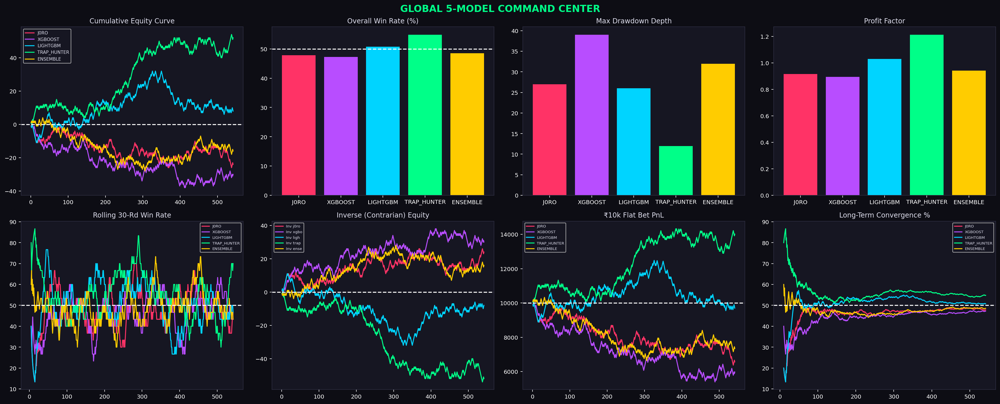
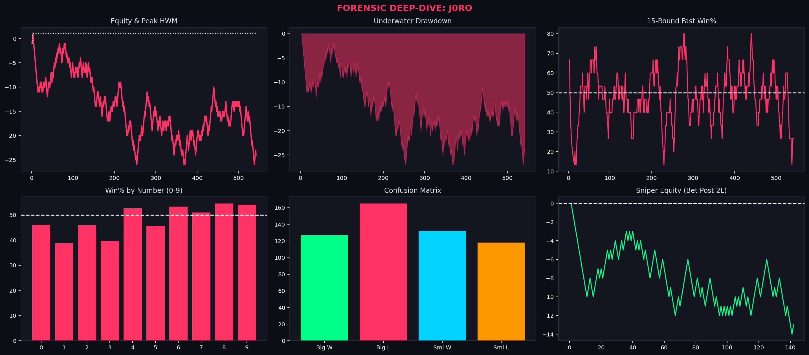
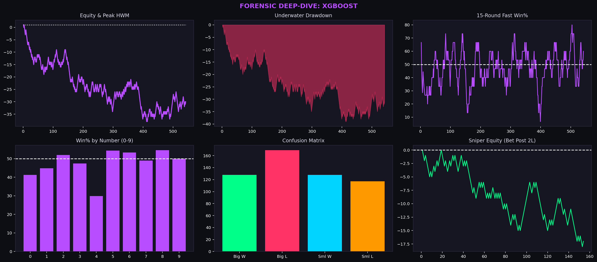
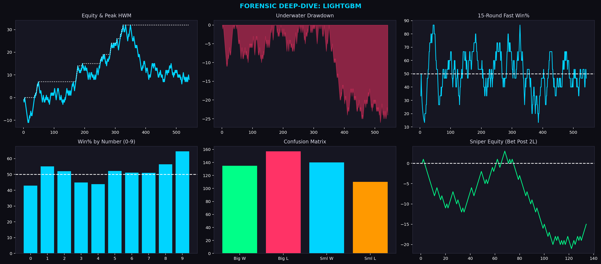
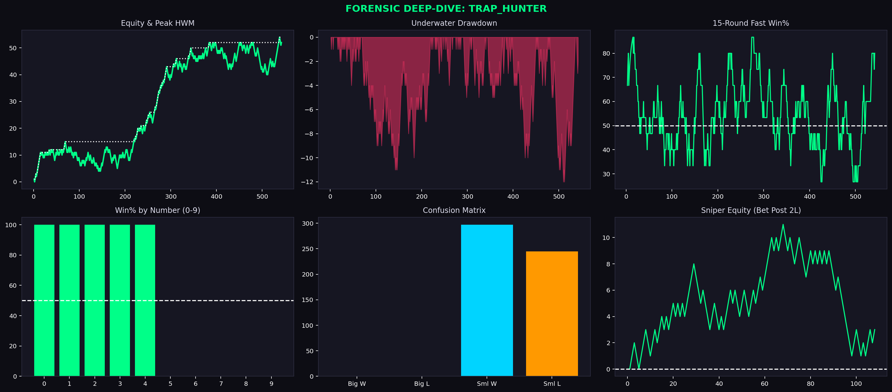
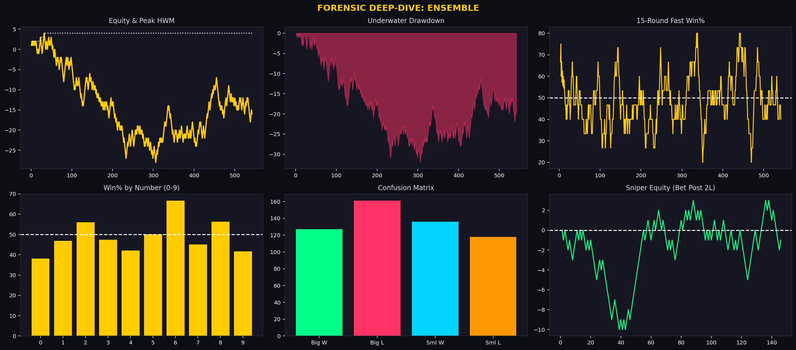
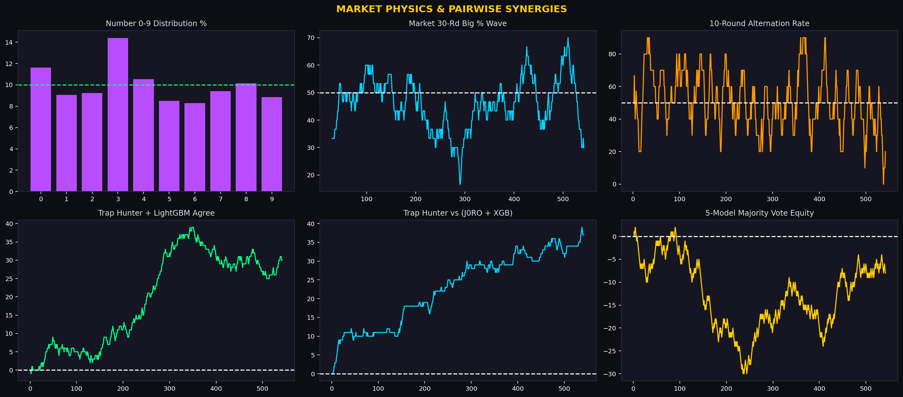

# 📊 Wingo 5-Model Quantitative Forensic Dashboard

Automated visual analytics and quantitative model validation.

### 📑 Full Analytical Report
- [Download Complete PDF Report](wingo_analytics_complete_report.pdf)

### 🖼️ Master Dashboards
#### `01_global_command_center.png`

#### `02_1_j0ro_deep_dive.png`

#### `02_2_xgboost_deep_dive.png`

#### `02_3_lightgbm_deep_dive.png`

#### `02_4_trap_hunter_deep_dive.png`

#### `02_5_ensemble_deep_dive.png`

#### `03_market_and_synergies.png`

